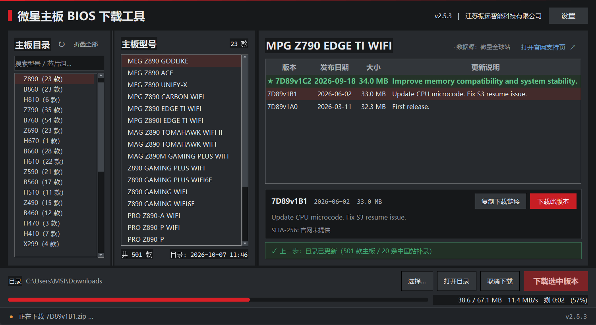

# 微星主板 BIOS 下载工具

> MSI Motherboard BIOS Downloader · 单文件 Windows 桌面工具
> 江苏振远智能科技有限公司

内置微星官网全部在售主板目录（约 500 款，含中国站特供补录），**三栏浏览器式布局**：左栏按「平台 → 芯片组」两级导航，中栏列出型号，右栏显示该型号全部 BIOS 历史版本与选中版本详情。选中即查、一键下载，带进度条与 SHA-256 校验。



## 功能

| 能力 | 说明 |
|---|---|
| 自动目录 | 启动即从官网产品接口拉取全量在售型号并本地缓存，之后可离线浏览；超过设定间隔后台刷新 |
| 中国站补全 | 每次刷新自动比对 `msi.cn`，把大陆特供 / 渠道板按芯片组补录进目录 |
| 双站 BIOS 回退 | 全球站查不到（特供型号）自动回退中国站，下载直链同步切换，状态栏标注数据源 |
| 断点续传 | 取消 / 失败保留 `.part` 分片，下次续传；服务端不支持 `Range` 时回退全量重下 |
| SHA-256 校验 | 边下边算，与官网公布值不一致会明确警告 |
| 状态记忆 | 窗口几何、上次型号、保存目录、目录树展开状态全部持久化（原子写，断电不留半截 JSON） |
| DNS 自愈 | 系统 DNS 解析不到 Akamai 域时自动切 DoH（阿里 / DNSPod），目录 / 查询 / 下载全链路生效 |
| 高 DPI | 声明 PerMonitorV2，全部度量按真实 DPI 换算，125% / 150% / 200% 下文字不发虚 |
| 弹簧动效 | Apple 语义解析解弹簧；读取系统「动画效果」开关，关闭时直接落终值；空闲零 CPU |

## 运行

- Windows 10 / 11 (x64)，无需 Python 环境，单文件 EXE 自包含
- 首次建目录需联网访问 `msi.com`；之后走本地缓存
- 命令行自检：`微星主板BIOS下载工具.exe --check`（无 GUI，结果写 `msi_bios_checker_selftest.log`）

## 开发

```bash
pip install curl_cffi
python msi_bios_checker.py
```

打包为单文件 EXE：

```bash
python -m PyInstaller msi_bios_checker.spec --noconfirm
```

## 质量门禁

仓库内 `_p_*.py` / `_opt_*.py` 是历次改动的**实测门禁**（布局几何、字体渲染、按钮间距、空状态结构等），`_gate_all.py` 一键跑全部：

```bash
python _gate_all.py        # 15 项
```

门禁以「真实 Tk 窗口 + 实测像素」为准，而非肉眼判断 —— 每项都附带**负向对照**（把修复回退，断言必须报红），避免写出恒真式。

## 技术要点

- **绕过 Akamai 防护**：官网由 Akamai 保护，普通 `urllib` / `requests` 会 403；本项目用 `curl_cffi` 的 `impersonate="chrome124"` 伪造 Chrome TLS 指纹
- **走官方 API 而非爬 HTML**：`getProductTagList` / `getProductList` / `support/panel?type=bios`
- **Tk 布局的坑**：`pack` 按调用顺序分配空间（`side="right"` 不是优先级）；`<Configure>` 不因内容变化而触发；`font measure` ≠ `winfo_reqwidth()`；`tk_setPalette` 会反向污染已存在控件

## 文档

| 文件 | 内容 |
|---|---|
| [CHANGELOG.md](CHANGELOG.md) | 全版本变更记录（含每处修复的实测数据） |
| [UI交互设计规范_v2.5.5.md](UI交互设计规范_v2.5.5.md) | 配色 / 字体 / 间距 / 让路优先级 / 门禁方法论 |
| [README.txt](README.txt) | 完整功能说明与历史沿革 |

## 许可证

[MIT](LICENSE) © 2026 江苏振远智能科技有限公司

## 免责声明

本项目为**第三方工具，与微星科技（MSI）无任何隶属或官方关联**。所有 BIOS 文件均从微星官方服务器直接下载，本工具不镜像、不修改、不重新分发固件。刷写 BIOS 存在风险，请自行判断并在刷写前确认断电保护。

代码以公司内部工具为背景开发，公开供学习参考。
